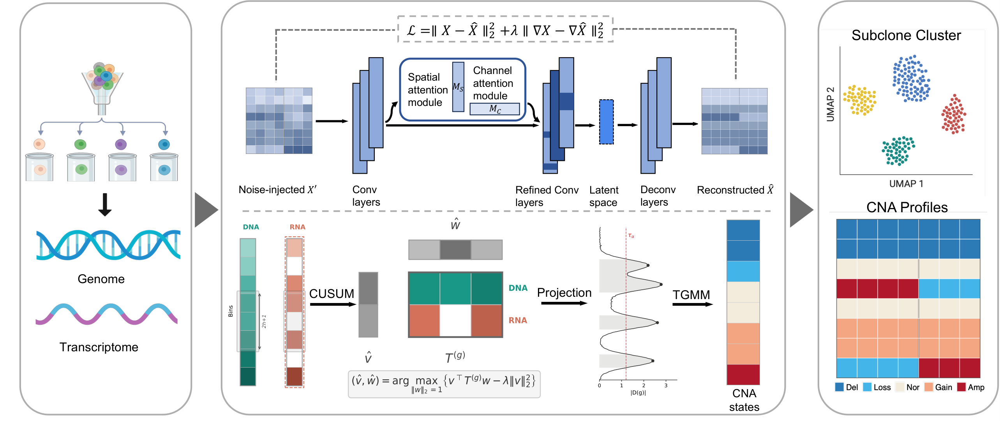

# MintCNA

[](LICENSE)
[](https://doi.org/10.64898/2026.06.26.734559)

MintCNA calls copy number alterations in single cells from scDNA-seq read counts or scATAC-seq fragment counts, optionally combined with scRNA-seq from the same cells. It denoises the count matrix with an attention-guided denoising convolutional autoencoder (AG-DCAE), finds breakpoints with a multivariate change-point scan, and assigns copy-number states with a truncated Gaussian mixture model (TGMM). Method details: [Bao, Qin & Xiao, bioRxiv 2026](https://doi.org/10.64898/2026.06.26.734559).



| Configuration | Primary layer | Second layer | Config |
|---|---|---|---|
| MintCNA<sup>DNA</sup> | scDNA-seq | — | `mode: dna` |
| MintCNA<sup>DNA+RNA</sup> | scDNA-seq | scRNA-seq | `mode: multi` |
| MintCNA<sup>ATAC</sup> | scATAC-seq | — | `mode: dna`, `preprocessing.modality: atac` |
| MintCNA<sup>ATAC+RNA</sup> | scATAC-seq | scRNA-seq | `mode: multi`, `preprocessing.modality: atac` |

**Contents:** [Installation](#installation) · [System requirements](#system-requirements) · [Tutorial](#tutorial) · [Your own data](#your-own-data) · [Parameters](#parameters) · [scATAC-seq input](#scatac-seq-input-10x-multiome) · [Output](#output) · [Reproducing the paper](#reproducing-the-paper) · [Citation](#citation)

## Installation

```bash
git clone https://github.com/WENHANB/MintCNA.git
cd MintCNA
conda env create -f environment.yml
conda activate mintcna

# one R package not on conda (once, inside the env):
Rscript -e 'install.packages("InspectChangepoint", repos = "https://cloud.r-project.org")'
```

For a GPU, set `denoise.device: "cuda"` in the config and use a `pytorch-cuda` build in place of `cpuonly` in `environment.yml`.

`environment.yml` pins the versions used for the paper (Python 3.10, PyTorch 2.9, R 4.4); `environment.lock.yml` is the complete solve of an environment that ran the demo end to end.

## System requirements

Tested on Red Hat Enterprise Linux 9.8 (x86_64) with R 4.4.3, Python 3.10 and PyTorch 2.8–2.9 (CPU builds). Other Linux distributions that run conda are expected to work; macOS and Windows have not been tested.

Hardware: no special hardware is needed. The demo (100 cells, 100-kb bins, chromosomes 1–22) runs end to end in 15–30 minutes on 4 CPU cores with 24 GB RAM (AMD EPYC 75F3). A GPU is optional and only accelerates the denoising step.

Typical install time: about 10 minutes (8 minutes for `conda env create -f environment.yml`, under a minute for the InspectChangepoint package).

## Tutorial

The repository ships a complete example in `demo/`: 100 simulated cells with paired scDNA + scRNA (chr1–22). Everything below runs from the repository root.

**1. The input files** (`demo/input/`) — four files, and this is what they look like:

`DNA_RC.csv` — DNA read counts, bins × cells; row names are the bin locations, columns are cells:

```
"","cell1","cell2","cell3","cell4","cell5"
"chr1:900000-1000000",85,47,84,69,91
"chr1:1000000-1100000",90,51,75,70,64
```

`cell_types.tsv` — one row per cell; `normal` marks the diploid reference cells, any other label is a tumor cell:

```
root	normal
cell1	normal
cell2	normal
cell11	clone2
```

`rna_counts.tsv` — RNA read counts, genes × cells (only for `mode: multi`):

```
gene_id	cell1	cell2	cell3	cell4
ENSG00000290825.1	0	0	0	2
ENSG00000223972.6	0	2	0	0
```

`genes.tsv` — gene locations (only for `mode: multi`):

```
gene_id	chr	start	end
ENSG00000290825.1	chr1	11869	14409
ENSG00000223972.6	chr1	12010	13670
```

No GC content, mappability or bin annotation is needed: MintCNA reads the bin locations from the row names and looks up GC/mappability in its bundled hg19/hg38 track.

**2. The config** (`demo/demo_config.yaml`) points at those files and sets the mode:

```yaml
input:
  dna_counts:      "demo/input/DNA_RC.RData"    # or DNA_RC.csv — same data, either form works
  cell_types:      "demo/input/cell_types.tsv"
  rna_counts:      "demo/input/rna_counts.tsv"
  gene_annotation: "demo/input/genes.tsv"
  genome: "hg38"
output:
  dir: "demo/output/"
mode: "multi"
```

**3. Run**

```bash
bash scripts/mintcna.sh --config demo/demo_config.yaml
```

About 15–30 minutes on 4 CPU cores (preprocessing → AG-DCAE → segmentation → calling): 15 min inside the conda environment, 26–30 min when R and PyTorch are loaded as separate cluster modules. On a SLURM cluster where R and PyTorch are separate modules, use `sbatch demo/test_pipeline.sbatch` instead.

**4. Results** land in `demo/output/mintcna_results.RData`:

```r
load("demo/output/mintcna_results.RData")
dim(cna_cn_matrix)      # 25892 bins x 90 tumor cells, integer copy number (2 = diploid)
head(cna_df_all)        # called segments: cell, chr, start, end, state, mean log2-ratio, CN
table(subclones)        # cell -> subclone
```

See [demo/README.md](demo/README.md) for every intermediate file.

## Your own data

1. Prepare the same files as in the tutorial:

| File | Format |
|---|---|
| Read counts (scDNA reads or scATAC fragments) | CSV, bins × cells, integer counts; row names `chr1:900000-1000000`. Any bin size. |
| Cell types | TSV: cell ID, `normal` column (`normal` = diploid reference cells) |
| RNA counts (multi mode) | TSV, genes × cells, integer counts |
| Gene annotation (multi mode) | TSV: `gene_id, chr, start, end` |

2. Copy `config/default_config.yaml`, set the `input:` paths and `input.genome` (`hg19` or `hg38`). Every parameter is documented in that file (see [Parameters](#parameters)).

3. Run:

```bash
bash scripts/mintcna.sh --config my.yaml
```

or stage by stage (when R and PyTorch live in different cluster modules):

```bash
Rscript scripts/run_mintcna.R --config my.yaml --stage preprocess
python scripts/run_denoise.py --config my.yaml --input out/l2r_dna.csv --output out/ae_dna.csv --latent out/latent_z.csv
Rscript scripts/run_mintcna.R --config my.yaml --stage all_post_denoise
```

To sweep the calling threshold without repeating the scan: `--stage scan` once, then `--stage call --alpha <a> --tag <name>` per value (`--st`, `--eps`, `--h` work the same way).

## Parameters

All parameters live in `config/default_config.yaml`; these are the ones that change the result.

**AG-DCAE denoising** (`denoise:`)

| Parameter | Default | What it does |
|---|---|---|
| `sigma` | 0.08 | Standard deviation of the Gaussian noise added to each input profile during training; the network learns to remove it. Increase for stronger denoising (smoother profiles, at the risk of flattening small real events); decrease for lighter denoising. |
| `edge_lambda` | 0.2 | Weight of the edge-preserving term of the loss, the mean squared error of the bin-to-bin differences. Increase to keep copy-number breakpoints sharper; decrease and the reconstruction becomes smoother across breakpoints. |
| `latent_dim` | 250 | Size of the bottleneck. Smaller compresses more and removes more noise but can lose small events; larger keeps more detail. |
| `kernel_size` | 5 | Width, in bins, of the convolution kernels. Larger kernels smooth over longer stretches of the genome; smaller ones act more locally. |
| `alpha` | 0.1 | Strength of the attention gate, `x + alpha * (attention(x) - x)`. 0 disables the attention module; larger values let it re-weight features more strongly. |
| `patience` | 15 | Early stopping: training stops after this many epochs without improvement of the validation loss. Larger values train longer. |

**Change-point detection and calling** (`segmentation:`, `calling:`)

| Parameter | Default | What it does |
|---|---|---|
| `segmentation.h` (`--h`) | 5 | Half-window, in bins, of the local change-point scan. Larger h detects longer events and ignores short ones, giving fewer breakpoints; smaller h picks up shorter events but is more sensitive to noise. Changing h re-runs the scan. |
| `segmentation.alpha` (`--alpha`) | 0.05 | Breakpoint threshold: a position is a breakpoint if its score exceeds the (1 - alpha) quantile of the empirical null. Smaller alpha is stricter and gives fewer breakpoints; larger alpha gives more. Can be swept with `--stage call` without re-running the scan. |
| `calling.n_states` (`--st`) | 5 | Number of copy-number states fitted: 3 (loss / neutral / gain) or 5 (deletion / loss / neutral / gain / amplification). |
| `calling.eps` (`--eps`) | 0.30 | Neutral band of the 3-state model: a segment whose mean lies within +/- eps of zero is called neutral. Larger eps calls fewer alterations; smaller eps calls more. `--eps0` and `--eps1` set the loss and gain side separately. |

## scATAC-seq input (10x Multiome)

Bin a Cell Ranger ARC `fragments.tsv.gz` and build the input files:

```bash
zcat fragments.tsv.gz | awk -F'\t' -v CELLS=cells.tsv -v BLACKLIST=hg38-blacklist.v2.bed \
    -v W=500000 -v MINFRAGS=3000 -f scripts/atac_bin_fragments.awk > sample_counts.tsv

Rscript scripts/make_atac_input.R --counts sample_counts.tsv --cells cells.tsv \
    --out input/sample --genome hg38 --width 500000
```

`cells.tsv` has columns `barcode`, `is_reference` (TRUE for non-malignant reference nuclei) and optionally `cell_type`. Then in the config:

```yaml
preprocessing:
  modality: "atac"
  mappability_min: 0.5
  valid_min: 0.5
  max_zero_frac: 0.85
segmentation:
  h: 15            # 15 bins x 500 kb
calling:
  n_states: 3
  eps: 0.20
```

## Output

`mintcna_results.RData` in `output.dir`:

| Object | Description |
|---|---|
| `cna_cn_matrix` | Copy-number matrix, bins × cells (2 = diploid) |
| `cna_df_all` | Called segments: cell, chr, start, end, state, mean log2-ratio, CN |
| `subclones` | Cell → subclone assignment |

Also written: the denoised matrix (`ae_dna.csv`) and latent embedding (`latent_z.csv`).

## Reproducing the paper

`reproduce/` holds the scripts behind the results and figures of the paper (simulation, MintCNA runs in multi-omics mode, benchmark runs of all compared methods, evaluation, Figures 2–5 and Supplementary Figures 1–9), with a README that gives the order. The simulated datasets are deposited on Zenodo (see the paper's Data availability statement).

## Citation

```bibtex
@article{bao2026mintcna,
  title   = {MintCNA: A Unified Framework for Integrative Copy Number Profiling with Single-Cell Multi-Omics Data},
  author  = {Bao, Wenhan and Qin, Fei and Xiao, Feifei},
  journal = {bioRxiv},
  year    = {2026},
  doi     = {10.64898/2026.06.26.734559}
}
```

## License and contact

GPL-3.0. Wenhan Bao and Feifei Xiao (feifeixiao@ufl.edu), Department of Biostatistics, University of Florida. Questions and bug reports: GitHub issues.
